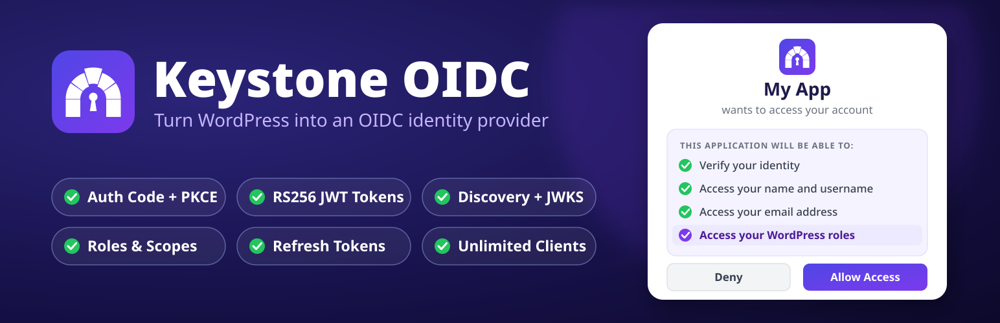

# Keystone OIDC

[](https://github.com/wenisch-tech/wordpress-keystone-oidc/actions/workflows/ci.yml)
[](https://github.com/wenisch-tech/wordpress-keystone-oidc/releases/latest)
[](https://keystone-oidc.wenisch.tech/)



Keystone OIDC turns a WordPress site into an OpenID Connect identity provider. Other applications (dashboards, CLIs, mobile apps, anything that speaks OIDC) can sign users in against the WordPress user database, without a separate identity provider.

This plugin was created because the existing ways to run WordPress as an OIDC provider fall short: some charge for basic functionality, some are not properly maintained, and some lack features that real setups need.

Keystone OIDC is open source (GPL v2 or later), will stay open source and no functionality will be moved behind a paid tier. If you like the project I would appreciate a rating on the official plugin page on WordPress.org: **[wordpress.org/plugins/keystone-oidc](https://wordpress.org/plugins/keystone-oidc/)


## What it does

- Authorization Code flow with PKCE (`S256` and `plain`), refresh tokens with single-use rotation, and a consent screen.
- RS256-signed access and ID tokens, a JWKS endpoint and an OIDC discovery document.
- Several clients, each either confidential (client secret) or public (no secret, PKCE required). Native apps can use `https` redirects or reverse-domain schemes such as `com.example.app:/callback`.
- Scopes `openid`, `profile`, `email` and `roles`.
- Client secrets are stored hashed and shown once. Signing keys can be rotated from the admin.
- Filters and actions to restrict who may sign in, add claims, change token lifetimes and revoke tokens. See [Extending with hooks](docs/Extending.md).

## Requirements

- WordPress 5.6 or later and PHP 7.4 or later, with the `openssl` and `json` extensions.
- Pretty permalinks enabled (**Settings → Permalinks**). The plugin registers rewrite rules that don't work with the plain `?p=123` structure.

## Installation

### From the WordPress plugin directory (recommended)

1. In WordPress go to **Plugins → Add New** and search for **Keystone OIDC**.
2. Click **Install Now**, then **Activate**.

The plugin is listed at [wordpress.org/plugins/keystone-oidc](https://wordpress.org/plugins/keystone-oidc/), and updates arrive through the normal WordPress update mechanism.

### From a GitHub release (optional)

1. Download `keystone-oidc-x.y.z.zip` from the [releases page](https://github.com/wenisch-tech/wordpress-keystone-oidc/releases).
2. Go to **Plugins → Add New → Upload Plugin**, upload the ZIP and activate it.

Or unzip the archive into `wp-content/plugins/` and activate the plugin there. Updates are then manual.

On activation the plugin creates its database tables, generates an RSA-2048 signing key pair and flushes the rewrite rules.

## Quick start

1. Open **OIDC Provider → Add Client**, enter a name and the redirect URI(s) of your application, and choose the client type.
2. Copy the client ID and, for confidential clients, the client secret. The secret is shown only once.
3. Point your OIDC library at the discovery URL:

   ```
   https://your-site.example.com/wenisch-tech/keystone-oidc/.well-known/openid-configuration
   ```

4. Configure the client ID, the secret and the redirect URI in your application and request the `openid` scope (plus `profile`, `email` or `roles` as needed).

More detail: [Quick start](docs/Quick-Start.md), [Admin guide](docs/Admin-Guide.md), [Client types](docs/Client-Types.md).

## Endpoints

All paths are relative to the site root.

| Endpoint | Path |
|---|---|
| Discovery | `/wenisch-tech/keystone-oidc/.well-known/openid-configuration` |
| Authorization | `/wenisch-tech/keystone-oidc/oauth/authorize` |
| Token | `/wenisch-tech/keystone-oidc/oauth/token` |
| UserInfo | `/wenisch-tech/keystone-oidc/oauth/userinfo` |
| JWKS | `/wenisch-tech/keystone-oidc/oauth/jwks` |

Parameters, responses and error codes are in the [endpoint reference](docs/Endpoint-Reference.md). Claims per scope are in [Scopes and claims](docs/Scopes-And-Claims.md).

## Documentation

The documentation is published at **[keystone-oidc.wenisch.tech](https://keystone-oidc.wenisch.tech/)**. The same pages are in the [`docs/`](docs/README.md) folder of this repository.

| Topic | Page |
|---|---|
| How the flow, tokens and keys work | [How it works](docs/How-It-Works.md) |
| Public and confidential clients, native apps | [Client types](docs/Client-Types.md) |
| Hooks, custom claims, revocation | [Extending with hooks](docs/Extending.md) |
| Hardening notes and reporting a vulnerability | [Security](docs/Security.md) |
| Common problems (404 on endpoints, redirect URI errors, …) | [Troubleshooting](docs/Troubleshooting.md) |
| Changes that need attention when updating | [Upgrading](docs/Upgrading.md) |

## Development

Contributions are welcome:

1. Fork the repository and create a branch.
2. Follow the [WordPress Coding Standards](https://developer.wordpress.org/coding-standards/wordpress-coding-standards/).
3. Use [Conventional Commits](https://www.conventionalcommits.org/) (`feat:`, `fix:`, `docs:`, …). The release version is derived from them.
4. Open a pull request against `main`.

### Testing a branch

Every push to a branch other than `main`, and every pull request, builds an installable ZIP and attaches it to the [CI run](https://github.com/wenisch-tech/wordpress-keystone-oidc/actions/workflows/ci.yml) as an artifact (kept for 14 days). Download it and install it through **Plugins → Add New → Upload Plugin**. These builds are versioned `x.y.z-dev.N` or `x.y.z-pr.N.M`, so they can't be mistaken for a release.

### Releases

A push to `main` runs the [CI workflow](.github/workflows/ci.yml), which computes the next version from the commit messages, updates the version headers and changelog, publishes a GitHub release with the ZIP and deploys to WordPress.org. No manual tagging is needed.

## Security

Please report vulnerabilities through a [private security advisory](https://github.com/wenisch-tech/wordpress-keystone-oidc/security/advisories/new) rather than a public issue.

## License

[GPL v2 or later](https://www.gnu.org/licenses/gpl-2.0.html), the same license as WordPress.
