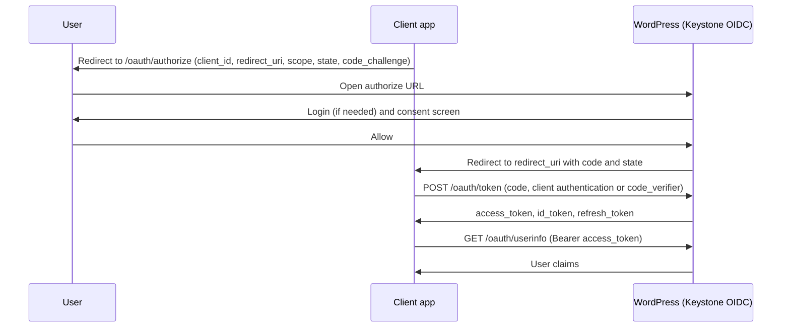

## Authorization Code flow

1. The client sends the browser to `/oauth/authorize`.
2. If the user isn't logged in, the normal WordPress login runs and returns to the authorize endpoint.
3. The consent screen lists the requested scopes. The user chooses **Allow** or **Deny**.
4. On approval a single-use **authorization code** (valid 10 minutes) is issued and the browser is redirected to the registered `redirect_uri`.
5. The client exchanges the code at `/oauth/token`. How it proves its identity depends on the [client type](Client-Types.md).
6. The plugin returns an access token and an ID token (RS256 JWTs) and a refresh token.

## Token lifetimes

| Token | Lifetime |
|---|---|
| Authorization code | 10 minutes, single use |
| Access token (JWT) | 1 hour |
| ID token (JWT) | 1 hour |
| Refresh token | 30 days, single-use rotation |

Each refresh token is revoked when used, and a new one is issued together with a fresh access token.

The lifetimes can be changed with filters, see [Token lifetimes](Extending.md#token-lifetimes). A user's tokens are revoked when the user is deleted or changes or resets their password, see [Revoking tokens](Extending.md#revoking-tokens).

## Signing keys

On activation the plugin generates an RSA-2048 key pair. The private key stays in the options table; the public key is published at the JWKS endpoint, so clients verify tokens without any shared secret. The `kid` header in each JWT identifies the signing key.
